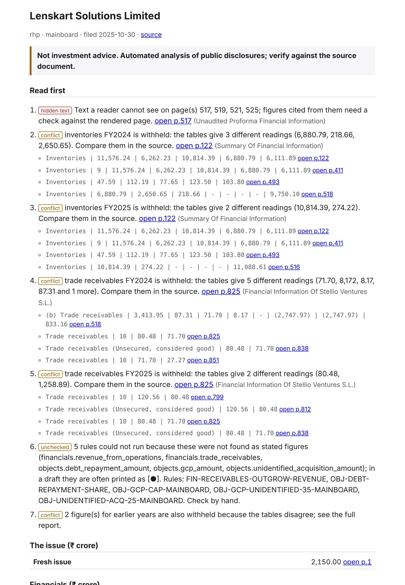
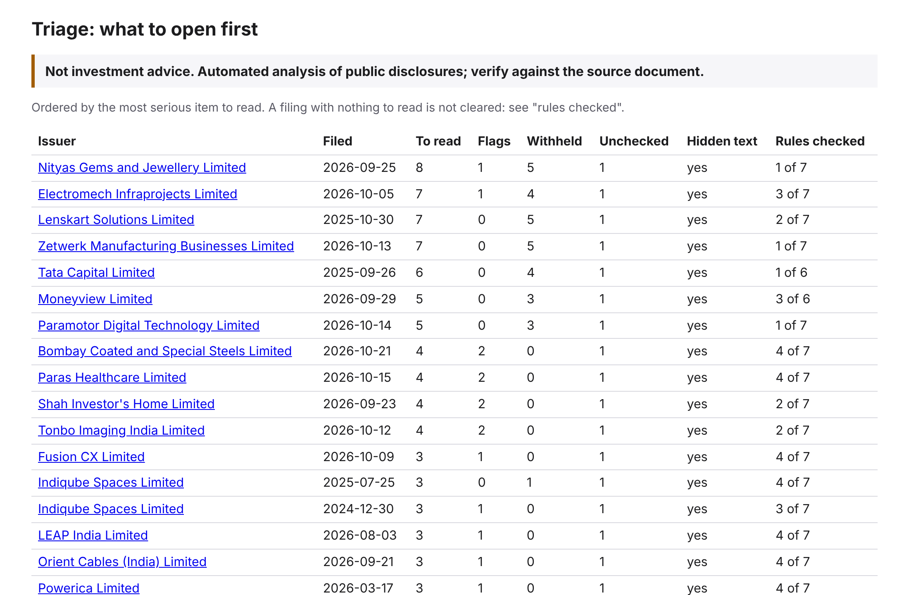
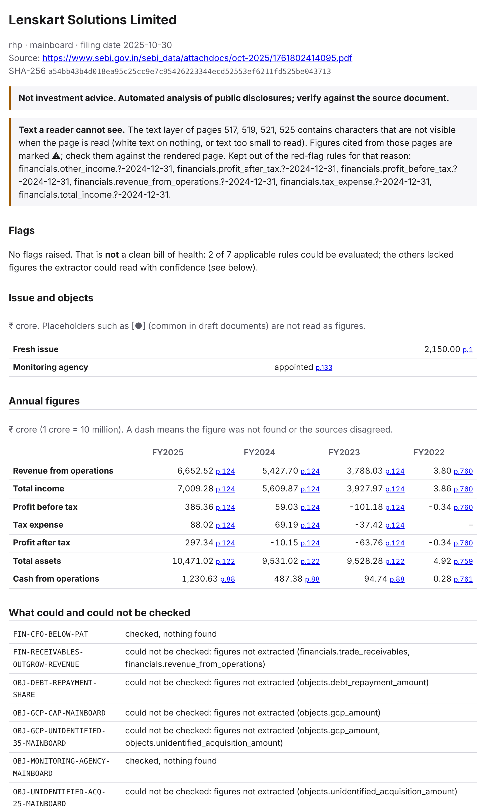

# RedHerring

**IPO due diligence for Indian offer documents. It reads a DRHP, RHP or Prospectus, shows the
numbers that matter with the PDF page each one came from, flags what to check, and screens the
company against SEBI's eligibility rules. Everything runs on your own computer, with no AI model,
no cloud service and no API key.**

> Not investment or legal advice. This is automated analysis of public filings. Check every figure
> against the page it links to. The software prepares and checks; it never certifies or files.

---

## What it does, in short

- **Reads** a 400 to 1,500 page offer document and pulls out issue size, use of proceeds and the
  annual financials, each tied to its PDF page.
- **Checks itself.** A figure is shown only after it is found again on its cited page and agrees with
  the other tables in the document. If the document disagrees with itself, the figure is held back
  and you are told which pages to compare.
- **Tells you what to open first.** A one-page brief per filing and a table that ranks many filings.
- **Flags** things worth a closer look (cash that lags profit, receivables outrunning sales, vague
  use of funds, no monitoring agency).
- **Screens eligibility** under SEBI ICDR with 19 versioned rules, a review queue for anything
  uncertain, and a signed-off report with a full audit trail.
- **Compares versions**, for example a draft and the final prospectus, figure by figure.

## Who it is for

| You are | You get |
|---|---|
| An analyst or investor | The brief, the flags and the page links, so you open the right 10 pages instead of searching 800 |
| A compliance or banking team | The eligibility screening with evidence, a review queue and an audit trail |
| A developer | One Python package, a REST API, a web app and a labelled benchmark |

---

## All the features

### The reader (command line)

| Feature | What it gives you |
|---|---|
| **Parser** | Page-tagged text and tables, units (lakh, million, crore), column headers; text a person cannot see (tiny, off-page, white on white) is dropped and flagged |
| **Extractor** | Revenue, total income, profit before and after tax, total assets, cash from operations, trade receivables, borrowings; fresh issue, offer for sale, total size; general corporate purposes, unidentified acquisitions, debt repayment; monitoring agency; eligibility route (Reg. 6(1) or 6(2)) |
| **Verifier** | Re-reads every figure from its page; checks that statements add up (assets = equity + liabilities, income = revenue + other income, profit = PBT − tax); compares the same figure across tables; prefers the issuer's own figures over subsidiaries and peers; withholds a figure when definitions conflict |
| **12 red-flag rules** | Each is a small TOML file naming its SEBI clause, effective date and the date it was last checked; rules are skipped for filings and sectors they do not apply to |
| **Section map** | Which section (risk factors, objects, financial information, litigation ...) each page belongs to, read from the table of contents and checked against the headings |
| **Brief and triage** (`rh brief`) | A ranked "read first" list per filing, every item with its page link, the section it sits in and the table rows behind it; a triage table across filings |
| **HTML report** (`rh report`) | Everything found for one filing, plus what could not be checked |
| **Version diff** (`rh diff`) | What changed between two versions of one offering |
| **Benchmark** (`rh eval`) | Scores the extractor against 647 hand-labelled fields over 38 filings |
| **Fetcher** (`rh ingest`) | Downloads the public filings you list, politely (robots.txt, rate limit, hashes recorded) |

### The screening app (web app and API)

| Feature | What it gives you |
|---|---|
| **Document reading** | Finds each eligibility figure with its page, the value as printed, its unit and a confidence level; reads scanned pages with OCR when Tesseract is installed |
| **Page preview** | One click opens the exact PDF page beside the value |
| **Review queue** | Conflicting or uncertain values go to a person, who confirms, corrects or rejects each one with a reason; a value a person entered is never overwritten by a later run |
| **19 versioned rules** | ICDR Reg. 5 (ineligible entities), Reg. 6(1)(a)–(c) (net tangible assets, operating profit, net worth), Reg. 6(1)(d) and 6(2), Reg. 14 and 16 (promoter contribution, lock-in), minimum public offer, issue size and market cap, plus advisory checks on board, audit committee, track record, related-party transactions, auditor and litigation |
| **Rule explanation** | For each rule: the regulation, the calculation, the evidence with page links, and whether its source has been verified |
| **Gap planner** | What is missing or failing and how to fix it; "evidence missing" is kept apart from a real failure |
| **Careful outcomes** | The software never says a company is "eligible". Outcomes are `NO_FAILURE_IDENTIFIED`, `SCREENING_FAILURE`, `AWAITING_HUMAN_REVIEW`, `INSUFFICIENT_EVIDENCE` and `UNSUPPORTED_SCOPE` |
| **Reports** | Export as HTML, JSON or text; a reviewer signs off; every edit and decision goes into a permanent audit trail with the data version, ruleset and documents behind it |
| **Scope** | Main board. The SME platform is reported as unsupported by the screening app (the reader does read SME filings) |

---

## Screenshots

### The reader

The brief for one filing (Lenskart's RHP). Each item names its page and section and shows the table
rows behind it. A figure the tables disagree on is listed to check, not shown.



The triage table ranks every filing by what needs reading first.



The full report for a filing, with every number linked to its page.



### The screening app

*Taken from the app processing a real public DRHP (Vardaan Biotech Limited, filed with SEBI).*

<table>
<tr>
<td width="50%" valign="top"><br><b>Extracted fields</b> with page, printed value, unit and confidence.</td>
<td width="50%" valign="top"><br><b>Page preview</b> next to the value, to check it in seconds.</td>
</tr>
<tr>
<td valign="top"><br><b>Review queue</b> for conflicting or uncertain values.</td>
<td valign="top"><br><b>Rule detail</b> with regulation, calculation and evidence.</td>
</tr>
<tr>
<td valign="top"><br><b>Gap planner</b>: what is missing or failing and how to fix it.</td>
<td valign="top"><br><b>Rule explorer</b>: every rule tied to its SEBI provision.</td>
</tr>
</table>

---

## How to use it

You need Python 3.12 and [uv](https://docs.astral.sh/uv/). The web app also needs Node.js 20 or
newer. Tesseract is optional (OCR for scanned pages).

```bash
git clone https://github.com/VenkateshPanda0/ipo-due-diligence-engine.git
cd ipo-due-diligence-engine
uv sync
```

### A. Read a filing (command line)

Register a PDF you already have (nothing is downloaded), then run the steps in order. The
`--doc-id` is a short name you choose; it names every output file.

```bash
uv run rh --data-dir data add ~/Downloads/acme-drhp.pdf --doc-id acme_drhp_2026 \
    --issuer "Acme Ltd" --doc-type drhp --platform mainboard --filed 2026-09-01
uv run rh --data-dir data parse      # PDF to page-tagged text and tables
uv run rh --data-dir data analyze    # extract, verify, cross-check, run the rules
uv run rh --data-dir data brief      # one-page brief per filing + triage table
uv run rh --data-dir data report     # full HTML report per filing
```

To work from public filings instead, list them in `data/sources.toml` (copy a `[[document]]`
block) and run `uv run rh --data-dir data ingest`, the one command that uses the network.
`--doc-type` is `drhp`, `rhp` or `prospectus`; `--platform` is `mainboard` or `sme`.
Add `--doc-id acme_drhp_2026` to `parse`, `analyze`, `brief` or `report` to run one filing only.

Open the files in `data/reports/`: `triage.html` first, then the brief of any filing, then follow
its "open p.N" links into the PDF. For a quick look in the terminal:

```bash
uv run rh --data-dir data brief --doc-id acme_drhp_2026 --text
```

Compare a draft with its final version, or measure the extractor:

```bash
uv run rh --data-dir data diff OLD_DOC_ID NEW_DOC_ID
uv run rh --data-dir data eval --labels-dir labels
```

### B. Screen a company (web app)

Run the two servers in two terminals:

```bash
# Terminal 1: API on http://127.0.0.1:8000  (API docs at /docs)
uv run rh serve

# Terminal 2: web app on http://localhost:3000
cd frontend && npm ci
NEXT_PUBLIC_API_BASE_URL=http://127.0.0.1:8000 npm run dev
```

Then in the browser:

1. **New screening case**: enter the company name and listing route.
2. **Upload** the DRHP PDF (SEBI: Filings, Public Issues).
3. **Review**: confirm or correct the values the app flagged.
4. **Run screening**, then open, export or sign off the report.

No database setup or API key is needed. Data is stored in `data/app/`. Docker is available for the
API: `docker build -t redherring . && docker run -p 8000:8000 -v rh-data:/data redherring`.
Settings are in `.env.example`.

### C. For developers

```bash
make test          # all Python tests
make gate          # format, lint, strict type-check and tests; real exit status
make frontend-test # frontend type-check and unit tests
```

---

## How it avoids being confidently wrong

| Principle | In practice |
|---|---|
| **Cite or stay silent** | Every value carries a page and the text it came from; the text is re-read from the PDF and a value that cannot be found on its page is discarded |
| **Cross-check the filing against itself** | A figure printed in four tables must agree across them; statements must add up; disagreement is shown, not settled by guessing |
| **Prefer the issuer's own figures** | Subsidiary and peer statements add up too, so figures from the front of the document and from group columns count for more |
| **Abstain when definitions conflict** | If one table prints owners' profit and another total profit including minorities, the tool declines to pick one |
| **Thresholds name their source** | A regulatory threshold gives its SEBI clause, effective date and last check date; a heuristic says it is one |
| **A person decides what is uncertain** | Anything doubtful goes to a review queue; a failure needs reliable evidence |
| **Untrusted input, no language model** | Filings are treated as hostile text; there is no model for hidden instructions to talk to (`docs/security.md`) |

## How well does it work?

Measured, not claimed. `rh eval` scores the reader against **647 hand-labelled fields (525 present,
122 deliberately absent) over 38 filings**: mainboard RHPs and DRHPs, SME drafts and prospectuses,
lenders, an abridged prospectus.

| | Filings | Present fields read correctly | Wrong | Withheld |
|---|---|---|---|---|
| All filings | 38 | 521/525 (99%) | 0 | 4 |
| Development (used to fix defects) | 34 | 458/462 (99%) | 0 | 4 |
| Held out (never used for a fix) | 4 | 63/63 (100%) | 0 | 0 |

The four withheld fields are cases where the document's own definitions conflict, or a table has no
unit; the tool declines to guess. The honest number is the **first run on filings it had never
seen**, with labels committed before the extractor ran: 76%, 76%, 97%, 54%, 87%, 87%, 100%, 100%,
89%, 95%, 57% (one short abridged prospectus) and 100% over twelve sets, with zero wrong values since
set 9 (`docs/heldout-run-N.md`). The section map reads 29 of 29 labelled section starts correctly.
The screening app was measured on 13 real DRHPs with 0 wrong values on 12 eligibility figures each.

Known limits:

- Labels were written by an AI reading the PDFs with a different tool; four early labelling errors
  were found and disclosed. A person has not yet audited a sample, so treat accuracy as strong
  evidence, not proof.
- Lenders, SME prospectuses and scanned filings are the least tested.
- The screening app's SCRR and exchange thresholds rest on secondary sources and are marked
  unverified in the app; no securities lawyer has reviewed the rules.
- The two parts share one package but not yet one pipeline: the screening app still uses its own
  extraction (including OCR). The plan merges them (`docs/plan.md`, Phase 5).

## The red-flag rules (reader)

| Area | Rule | Severity |
|---|---|---|
| Financials | Operating cash flow persistently below reported profit | medium |
| Financials | Trade receivables growing much faster than revenue | medium |
| Objects | No monitoring agency although the issue is above the threshold (mainboard, SME, SME before 8 Mar 2025) | high |
| Objects | General corporate purposes close to the regulatory cap (mainboard, SME, SME before 8 Mar 2025) | medium |
| Objects | General corporate purposes plus unidentified acquisitions close to the combined cap | medium |
| Objects | Unidentified acquisitions close to their own cap | medium |
| Objects | More than half of the fresh issue repays borrowings (heuristic) | low |
| Issue | Offer for sale close to the SME limit | medium |

A flag is a prompt to read the cited pages, not a verdict.

## What is planned

Text-level checks (related-party transactions, pledges, litigation, tax, customer concentration,
auditor remarks), a DRHP-to-RHP text diff, OCR for scanned filings, and an issuer-side preparer
(input templates, eligibility arithmetic, a draft consistency checker, a DRHP skeleton and a filing
checklist). Full plan with the test each item must pass: `docs/plan.md`.

## Project layout

```
src/redherring/            the reader: ingest, parse, extract, verify, flags, eval, brief, segment, diff, cli
src/redherring/screening/  the screening app: API, rules, engine, review workflow, reports, OCR pipeline
frontend/                  the web app (Next.js)
tests/  tests/screening/   reader tests and screening tests
data/                      filings list and manifest; downloaded and generated files are git-ignored
labels/                    hand-labelled benchmark fields and section start pages
docs/                      plan, decisions, status, held-out runs, security; docs/screening/ for the app
tools/                     gate script and labelling helpers
benchmark/ scripts/ sample_data/   the screening app's benchmark, scripts and synthetic samples
```

## Documentation

| | |
|---|---|
| `docs/plan.md` | The plan: phases, gates, what each needs |
| `docs/status.md` | Every current number and known defect |
| `docs/decisions.md` | Design decisions and their trade-offs |
| `docs/security.md` | Threat model for untrusted PDFs |
| `docs/heldout-run-1.md` ... `-12.md` | Each held-out run: what failed, why, what changed |
| `docs/screening/` | Screening app: architecture, regulations, validation, review workflow, benchmark |

## Data hygiene

Only public filings are fetched, with robots.txt respected, a per-host rate limit and a descriptive
User-Agent; source URLs and SHA-256 hashes are recorded. PDFs, parsed output and generated reports
are git-ignored: regenerate them with the commands above.

## Licence

MIT (see `LICENSE`).
