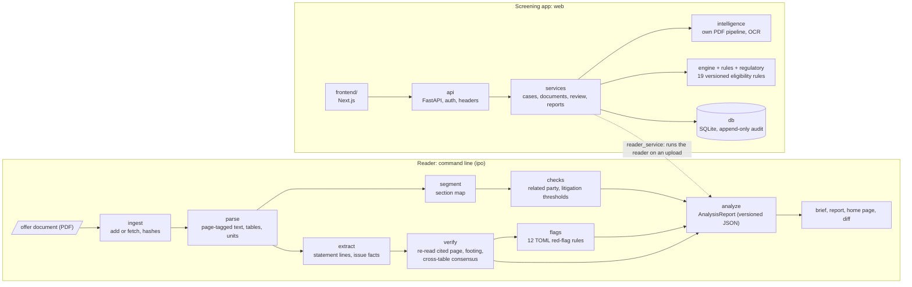

# Architecture

IPO Engine is one Python package (`ipo_engine`) with a web front end. It has two ways in, a command
line (the **reader**) and a local web app (the **screening app**), over one idea: **a figure is shown
only if it carries the page it came from and was found again on that page.**



Read it left to right. The reader turns a PDF into a verified, page-cited analysis and pure functions
turn that into pages. The screening app lets a person run a case through eligibility rules, review what
is uncertain and sign off; its "Reader brief" tab is the one place the two meet. The detail of each
half: the reader below; the screening app in [`screening/ARCHITECTURE.md`](screening/ARCHITECTURE.md)
(layers, rules, review workflow). Version numbers for each output: [`VERSIONING.md`](VERSIONING.md).
Threat model and API security: [`security.md`](security.md). How a release is cut:
[`RELEASING.md`](RELEASING.md).

## The reader (`src/ipo_engine/`, everything except `screening/`)

| Package | Job | Never does |
|---|---|---|
| `ingest` | registers a local PDF (`local.py`) or downloads a public one (`fetch.py`, the only module allowed to use the network); writes `data/manifest.jsonl` with hashes | parse |
| `parse` | PDF → page-tagged text blocks and tables, units, column headers; drops text a reader cannot see | interpret figures |
| `segment` | table of contents → section map, each entry checked against the heading on its page | guess a section |
| `extract` | statement lines, issue facts, objects of the issue; `consensus` chooses between tables | read the PDF again |
| `verify` | re-reads each cited figure from the PDF with a second code path (`cited`); accounting identities (`footing`) | change a value |
| `checks` | text-level evidence checks (related-party rows); report what the document prints | sum, infer or give a verdict |
| `flags` | rule engine over verified facts; each rule is a TOML file with its clause and dates | run on unverified facts |
| `analyze` | runs all of the above for one document → `AnalysisReport` (versioned JSON) | |
| `brief`, `report_html`, `diff` | pure functions from `AnalysisReport` to pages; they restate, they read nothing | add a new way to be wrong |
| `eval` | scores extraction against hand-written labels | |
| `cli` | the `ipo` command | |

Two version numbers guard cached output: `PARSER_VERSION` and `ANALYSIS_VERSION`. Output written by an
older version is refused with a message, never silently reused.

## The screening app (`src/ipo_engine/screening/`, `frontend/`)

A FastAPI service and a Next.js app for eligibility screening with human review. Layers, with
import boundaries enforced by `tests/screening/unit/test_import_boundaries.py`:

`api` (HTTP, auth) → `services` (cases, documents, review, reports, reader) → `intelligence` (its own
PDF pipeline, with OCR) and `engine` + `rules` + `regulatory` (versioned rules, decisions, gaps) →
`models`; `db` is SQLite through SQLAlchemy with an append-only audit trail. Details:
`docs/screening/ARCHITECTURE.md`.

## Where the two meet

`screening/services/reader_service.py` runs the reader on an uploaded document in the background,
caches the brief by content hash and reader version, and serves it at
`GET/POST /api/v1/documents/{id}/reader`. The document page in the web app shows it under "Reader
brief", with every page reference opening the page preview. It never changes case data.

What is still separate: the eligibility figures are extracted by `screening/intelligence`, not by
the reader. Replacing that with the reader's verified core is Phase 5 of `plan.md`; it is done one
figure family at a time, each against the screening benchmark, because it changes outcomes.

## Data on disk

```
data/manifest.jsonl, sources.toml   tracked: which filings, where from, hashes
data/raw, parsed, extracted, reports, eval, labeltext   git-ignored, regenerable
data/app/                           git-ignored: the web app's database, uploads, reader cache
labels/                             tracked: hand-written benchmark labels
```

## Rules that hold everywhere

1. No language model and no network outside `ingest/fetch.py` (`tests/test_offline.py`).
2. Untrusted input: a filing is hostile text; HTML output is escaped; no script in generated pages.
3. Withhold instead of guessing; say why and name the page.
4. Money is `Decimal` end to end, never a binary float.
